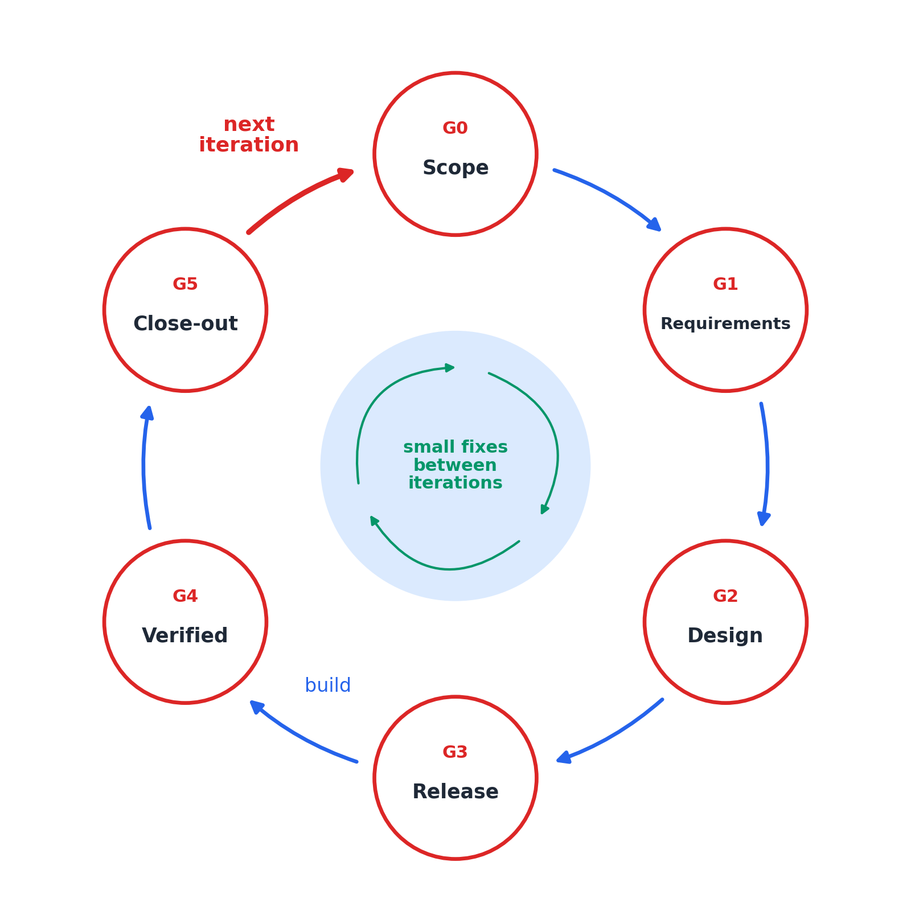

# minimalQMS

A lean, ISO 9001-style quality management system for hardware, run with AI agents and
decided by humans. It works for a team of one.

minimalQMS gives hardware development a backbone: requirements, design reviews, controlled
changes, traceable parts and builds, and lessons learned. Agents do the legwork and the
record-keeping. Humans make every decision.

## Why minimalQMS

### Less red tape, more design

Developing physical products under a quality system usually involves a lot of red tape:
document control, approval chases, purchasing paperwork, traceability records and audit
preparation. In industry, a large share of a product team's effort goes into this
supporting work rather than the design itself, and much of a traditional organization
exists only to keep that machinery running.

minimalQMS uses AI agents to take that load off, so designers can focus on designing:
- **Agents do the paperwork.** They draft change requests, prepare design reviews, write
  minutes, prepare purchase lists and keep build records. Humans review and approve.
- **Every change is tracked automatically,** with who made it, why, and who approved it.
  Nobody maintains a document register by hand.
- **Routine checks run on their own.** Incomplete BOMs, invalid part numbers and untraced
  parts are flagged before anything is released.
- **Only what ISO 9001 actually needs.** Eight one-page procedures, each marked as an ISO
  requirement or a minimalQMS choice ([ISO 9001 map](docs/ISO9001-MAP.md)).

### A backbone for projects without one

Many projects outside industry focus almost entirely on design, with little or no control
around it: build, try, fix, repeat. That works until a design has to be repeated, handed
over, shared or trusted.

More and more developers design by chatting with an AI agent. minimalQMS formalizes those
casual chats. Its guidelines, based on the same standards industry follows, let the agent
ask the questions that improve a design, at the moment they matter, and turn the answers
into records. Nobody has to learn a quality system:

> **Before ordering parts:** "The LED driver runs at 1.2 A. What should happen if the fan
> stops? Do we need a thermal cut-off?"
>
> **After a change:** "You moved the mounting holes. The lid from the last build won't fit
> any more. Is this a new revision, or a new part?"
>
> **After testing:** "Two of three units ran hotter than the others. Is that a problem
> with those parts, or with the design?"

The result is fewer surprises, designs that others can rebuild, a clear history to share,
and a project that improves from one iteration to the next.

## How it works

### Development is a cycle

Each iteration passes six gates, from scope to close-out, starting from the last released
revision. Lessons learned, problems found and feedback become the change requests for the
next iteration. Small fixes between iterations skip the gates. See the
[SOP overview](sops/README.md).

### Coworkable, not fully agentic
Humans and agents work on the **same** design. Either can change the CAD or the PCB, every
change records who made it, and agents never silently overwrite human work.

### Three kinds of interaction, one kind of approval
- **Check-ins** keep the human up to date. No decision is needed.
- **Working decisions** steer the work ("use the 0805 part"). They are captured, not approved.
- **Formal reviews** at gates work like a real review meeting. The agent prepares a package
  (grouped changes, where to look, before/after visuals, affected risks, findings from an
  independent AI reviewer) and walks the human through it. The human answers **yes or no**
  to a question that names exactly what is being approved.

Minutes are generated from the review, and the transcript is archived as evidence. Agents
never approve. See [docs/REVIEW-MODEL.md](docs/REVIEW-MODEL.md).

### Design source of truth
CAD owns the design; git owns the release record. At release, BOMs are exported from the
CAD tools into git with the CAD version they came from, and checked against the part data.

### Only as much process as needed
- **Risk-based traceability.** Critical parts are traced per unit, bulk hardware per
  purchase, consumables not at all.
- **No SOP before its process.** Each procedure is about one page and is written just
  before it is first needed.

## Why git?

Git has known problems as a QMS, especially for people who don't use it. minimalQMS uses git
as the **database**, not the interface: people work through agents and readable documents.
See [docs/RATIONALE.md](docs/RATIONALE.md), which answers the main critiques.

## The minimalQMS family

| Repo | What it holds | Changes |
|---|---|---|
| **minimal-qms** (this repo) | Process: SOPs and appendices, CI checks, product scaffold | Rarely, by revision |
| [**minimal-qms-ots-library**](https://github.com/kelvinchow23/minimal-qms-ots-library) | Off-the-shelf parts, prefix and project codes, purchasing tools, [searchable catalogue](https://kelvinchow23.github.io/minimal-qms-ots-library/) | With every purchase |
| minimal-qms-playbook *(planned)* | Work instructions and agent skills for engineering practice | As practice improves |
| Product repos | Custom parts, BOMs, reviews, builds and records of one product | Continuously |

Each product lives in its own repo, generated from a Copier template in this repo. Each
product records which QMS revision it was built under, and `copier update` offers later
revisions as a reviewable change.

## Showcases

- **Photoreactor:** [kelvinchow23/photo-reactor](https://github.com/kelvinchow23/photo-reactor)

## Status

Building QMS-rev A. See [docs/ROADMAP.md](docs/ROADMAP.md) for the plan.

Until QMS-rev A is tagged, minimalQMS is developed with lightweight branches and PRs.
After the tag, changes to minimalQMS follow its own change control.

## Open questions

- **Guided mode.** Which questions should the agent ask at each gate, and how does it
  adapt them to the project and the person? This is what gives a project without a formal
  process its backbone.
- **Interface beyond git.** What lets a non-technical team use this without seeing git?
  So far: agents as the main interface, readable generated documents, and the OTS
  library's catalogue site.

## Licence

[MIT](LICENSE). Use it, fork it, build products on it.
