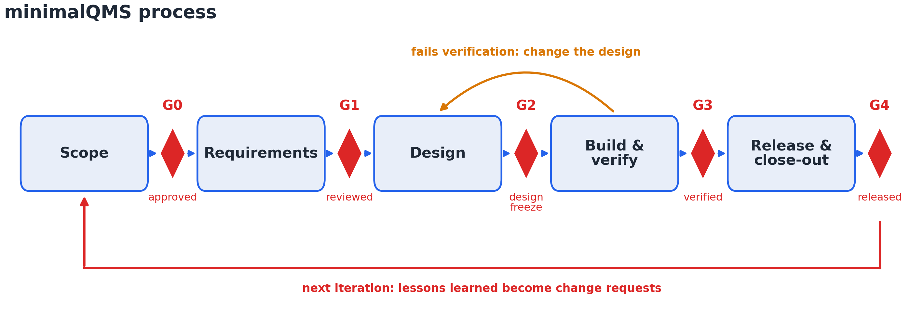

# minimalQMS

minimalQMS is a lightweight quality management system for hardware projects, built to be
run with AI agents. It's based on ISO 9001, trimmed down to what a small team, or one
person, can actually keep up with.

## Why minimalQMS

### Less bureaucracy, more design intent

If you've developed hardware under a quality system, you know how much of the job isn't
design. Keeping documents in sync, chasing approvals, filling in purchase paperwork,
checking the BOM against the parts list against what was actually ordered. Some of that
matters. A lot of it is overhead.

The idea here is to hand that overhead to agents. They work on the CAD, the PCB and part
selection with you, and they take care of the admin around it: change requests, review
packages, minutes, purchase lists and build records. The cross-checking that used to take
an afternoon of flipping between spreadsheets runs automatically whenever something
changes. You stay in charge of the design, and you sign off on every decision.

There are eight procedures, each about a page long, and they follow ISO 9001
([how they map to the standard](docs/ISO9001-MAP.md)).

### Formalizing informal design projects

A lot of hardware gets built without any formal process: personal builds, research
prototypes, open-source hardware, early prototypes at companies. The focus is on the
design. Build it, try it, fix it, repeat. That's a big part of why these projects can move
so much faster than formal ones. It gets harder when someone else needs to rebuild the
design, when you hand it over, or when you come back to it six months later and can't
remember why something is the way it is.

More and more of that work happens in conversations with an AI agent. minimalQMS turns
those conversations into a lightweight process without slowing them down. Start a project
from this repo and its companion repos, and you end up following the intent of the
standard (controlled, traceable designs) without having to think about it. Along the way
the agent asks the kind of questions a good reviewer would:

> "You moved the mounting holes. The lid from the last build won't fit anymore. Is this a
> new revision, or a new part?"
>
> "Two of three units ran hotter than the others. Is that the parts, or the design?"

When you get to a design review, or move on to the next stage, the agent summarizes the
chats so you can look back at how each decision was reached.

You don't need to read the procedures. They're here for anyone who wants to see how
things work, but the point is that you never have to open them. Start a project from this
repo and its companions, work with your agent the way you normally would, and the process
takes care of itself. If you look back through the project later, you'll find you followed
every procedure along the way.

## How it works

None of this has to be learned up front. It's described here for anyone curious about
what happens underneath.

### The process

A project goes through five stages, and each ends at a gate where you approve the work
before moving on. If a build fails verification, you don't start over: you change the
design, have that change reviewed, and build and test again until it passes. Once the
units are released, what you learned becomes the starting point for the next iteration.
Small fixes to a released design, like a hole that's slightly too small, go through a
change request on their own without the gates. The [SOP overview](sops/README.md) has the
details.

### Humans and agents work on the same design

Either one can change the CAD or the PCB. Every change records who made it, and an agent
never quietly overwrites something you did.

### Not everything is an approval

Most of the time you're just working with the agent. It tells you what it did, you tell it
what to do next, and none of that needs a sign-off. Approvals only happen at formal
reviews. The agent puts together a review package (what changed, where to look,
before-and-after images, the risks involved, and findings from a second agent that didn't
do the design work), walks you through it, and then asks a yes-or-no question about exactly
what's being approved. Agents never approve anything themselves. There's more in
[docs/REVIEW-MODEL.md](docs/REVIEW-MODEL.md).

### The CAD tools own the design

The design lives in your CAD tools. At release, the BOMs are exported into the project
repo along with the CAD version they came from, and checked against the part data.

### Only as much process as the risk calls for

Critical parts are traced unit by unit, bulk hardware by the order it came from, and
consumables not at all. Procedures are written just before they're first needed, not
ahead of time.

## Why git?

Git isn't an obvious choice for a quality system, especially for people who don't write
software. Here it's the database, not the interface. You work through agents and readable
documents, and git keeps the history underneath. [docs/RATIONALE.md](docs/RATIONALE.md)
goes through the usual objections.

## Related repos

| Repo | What's in it |
|---|---|
| **minimal-qms** (this repo) | The procedures, their forms and templates, checks, and the template for new projects |
| [**minimal-qms-ots-library**](https://github.com/kelvinchow23/minimal-qms-ots-library) | Off-the-shelf parts, purchasing tools and a [searchable catalogue](https://kelvinchow23.github.io/minimal-qms-ots-library/) |
| minimal-qms-playbook *(planned)* | Work instructions and agent skills for things like CAD practice and assembly instructions |

Each product gets its own repo, generated from the template here. It records which version
of minimalQMS it was built under, and can pick up newer versions later as a reviewable
change.

## Showcases

- Photoreactor: [kelvinchow23/photo-reactor](https://github.com/kelvinchow23/photo-reactor)

## Status

Working toward the first release, QMS-rev A. The plan is in [docs/ROADMAP.md](docs/ROADMAP.md).
