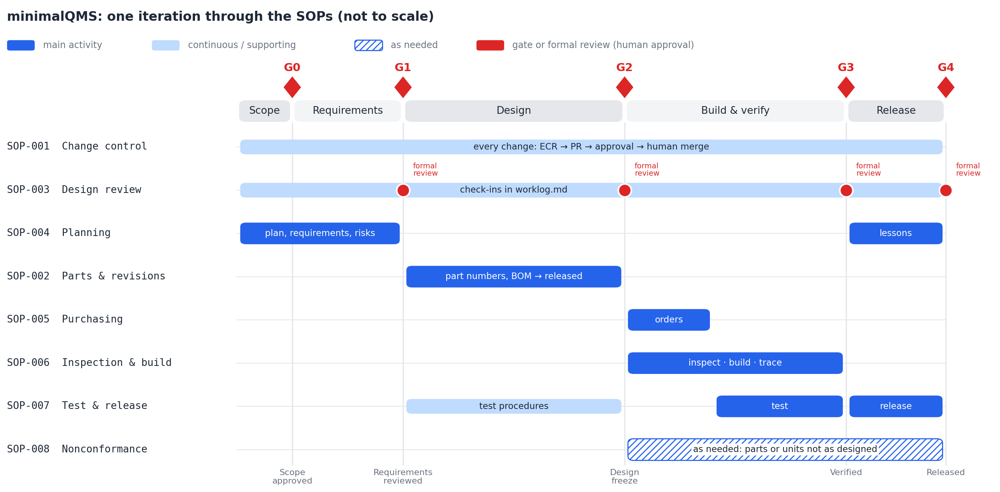

# SOP overview

minimalQMS procedures for QMS-rev A. Each SOP is about one page. Shared names, IDs and
file layout are defined in [docs/INTERFACES.md](../docs/INTERFACES.md). What ISO 9001
requires, and where each requirement is covered, is in
[docs/ISO9001-MAP.md](../docs/ISO9001-MAP.md).

| SOP | Title | What it controls | Main records | ISO 9001 |
|---|---|---|---|---|
| [001](SOP-001-document-and-change-control.md) | Document and change control | Versions, changes (ECR → PR → approval → human merge), what an approval must prove, roles, deviations, retention | `roles.yaml`, ECRs, PRs, `DEV-nnn` | 5.3, 7.5, 8.3.6, 8.5.6 |
| [002](SOP-002-parts-revisions-classes.md) | Part numbering, revisions and part classes | `CCC-NNNN` OTS parts, `PPP-NNNN` / `PPP-A-NNNN` custom parts and assemblies, revisions, lifecycle, A/B/C traceability classes, serial numbers | `parts.csv`, `bom.csv` | 8.4.2, 8.5.2 |
| [003](SOP-003-design-review.md) | Design review | Check-ins, working decisions and formal reviews; review packages, minutes and approval | `DR-nnn/`, `worklog.md` | 8.3.4, 8.3.6 |
| [004](SOP-004-design-planning.md) | Design and development planning | Phase gates G0–G5, plan dates, requirements, risks | `plan.yaml`, `gates.yaml`, `requirements.yaml`, `risks.csv` | 6.1, 8.3.2–8.3.5 |
| [005](SOP-005-purchasing-suppliers.md) | Purchasing and suppliers | Supplier approval; purchase list referring to the organisation's own requisitions and POs | `suppliers.csv`, `purchases.csv` | 8.4 |
| [006](SOP-006-inspection-build-records.md) | Incoming inspection and build records | Inspection by class, build configuration, what went into each unit | `build.yaml`, `inspection.csv`, `trace.csv` | 8.4.2, 8.5.1, 8.5.2 |
| [007](SOP-007-test-release.md) | Test and release | Test procedures, test equipment and calibration, results, unit release | `TP-nnn`, `equipment.csv`, `test_results.csv`, `release.yaml` | 7.1.5, 8.3.4, 8.6 |
| [008](SOP-008-nonconformance-corrective-action.md) | Nonconformance and corrective action | Containment, disposition, root cause, corrective action | `NC-nnn.md` | 8.7, 10.2 |
| 009 | Management layer *(held)* | Scope, policy, objectives, internal audit, management review, training | – | 4.3, 5.2, 6.2, 7.2, 9.2, 9.3 |

## How a product moves through the SOPs

Red diamonds are phase gates (SOP-004); red dots are formal reviews (SOP-003). Both require
a human approval. The figure is generated by `tools/make_gate_figure.py`.
